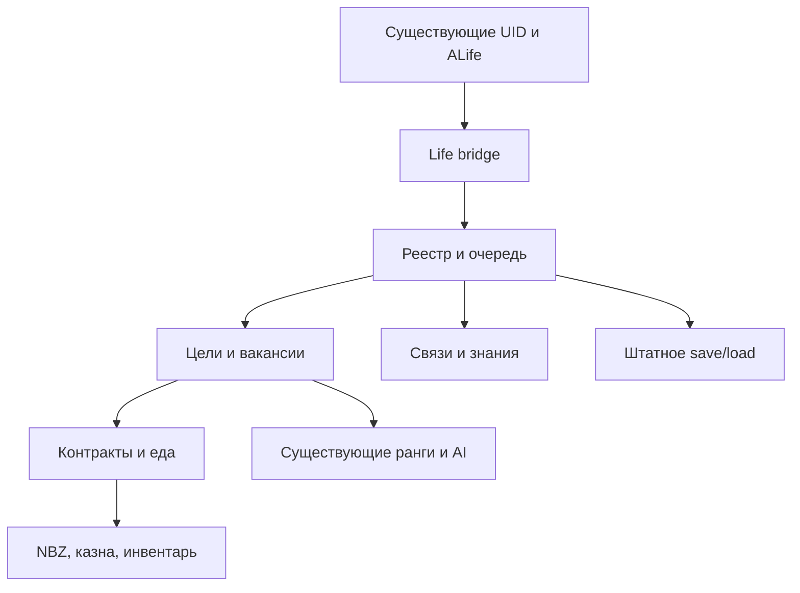

[Русский](../../../../snapshot-2026-10-28/13_Autonomous_Life_V1/API_CONTRACTS.md) · **English** · [Documentation index](../../INDEX.md) · [Translation notes](../../../TRANSLATION.md)

# Confirmed integration contracts

The sources of the current build were checked on 10/28/2026; native scenarios and limitations are listed separately. The names are not taken from the intended schema technical specification.

| Data Owner | API used | Contract |
|---|---|---|
| Personality | `cczmp_ops.person(npc)` | Returns the UID p<serial>; writes it to the server ALife storage. A dead NPC does not create a new identity. |
| Registry | `cczmp_ops.target_info(uid)` | A separate copy of the entry: object_id, object_name, section, faction, rank. |
| Legal restrictions | `cczmp_ops.hold_info(uid)` | Detention/containment blocks new work and assignment. |
| Service Storage | `cczmp_ops.service_state()` | Existing people/contracts/treasury; new contracts have kind=life_wage and key life:<uid>. |
| Personal accounts | `cczmp_bank.account_state(uid)` | Existing NBZ account. The first online registration can transfer 60% of NPC cash to the account; This is old bank behavior. |
| Translations | `cczmp_bank.transfer(source,target,amount)` | Checks balance, blocking, overflow; changes real accounts. |
| New bank adapter | `cczmp_bank.move_once(source,target,amount,key)` | Atomic posting to existing accounts/treasury with receipt. Repeating with the same parameters does not pay a second time; non-matching parameters are rejected. |
| Organizations | `exists`, `rank_count`, `set_object_rank`, `object_rank` from `cczmp_factions` | Existing affiliation and rank fields. For civilians ranks_count=0: the profession changes without the invention of a departmental rank. |
| ALife | `cczmp_runtime.resolve(token)` | Checks ID+name+section. The bridge additionally checks the server cczmp_person_key. |
| Persistence | `cczmp_items.world()` | Table inside alife_storage_manager; Autonomous partition v1 has been added, the old life partition has been preserved. |
| Time | `game.get_game_time():diffSec(ctime)`; `save_ctime` / `load_ctime` | Seconds of game time. Pausing does not reset the accumulated change; loading is excluded separately. |
| Food | `npc:inventory_for_each`, `se.parent_id`, `alife_release(se)` | Real bread/kolbasa/conserva. The owner is verified before making a reservation; after removal, the absence of the same token is confirmed. |
| Close behavior | Existing `beh@cczmp_life_staff_*` | The old module saves diagrams, dialogues, reactions. The new module conveys the needs/phase to it; the remaining AI schemes are preserved. |
| Services | `cczmp_emergency.dial/select/request`; existing ridehail/taxi | These modules are not replaced by the simulator. Full call/ride regression requires separate native scripts. |
| Test level transition | `_G.JumpToLevel(name)` | Standard debug function from _g.script, calls ChangeLevel through the game graph. In release life it is not used for instant movement. |

New public functions:

* `cczmp_life_core.register`, `enqueue`, `process`, `pump`, `pause`, `diagnostics`: registry and queue with per-frame work limit.
* `cczmp_life_economy.create_contract/work/payroll/eat`: contracts and consumption of physical resources. An hour of labor is counted only for a living free employee.
* `cczmp_life_careers.publish/eligible/apply`: vacancy, verification and appointment. The employer does not hire himself. There is no direct change to the native community.
* `cczmp_life_social.learn/share/deliver`: address knowledge with source and delay; `relationship` - limited connections; `org_update` - composition and continuity of groups.

Only numbers, strings, booleans and tables are saved without loops. Native userdata does not fit into the new section. Before the operation, tokens are resolved again. The exception is CTime in the standard pstor_ctime, which is serialized by the existing engine system.

A payroll period stores hours earned, status, amount, and source. Consecutive paid periods are consolidated; unpaid ones are saved and repeated in the queue. At the bank, receipts are not thrown away to free up memory: reaching the limit stops new calculations.

Scheme of real connections:

