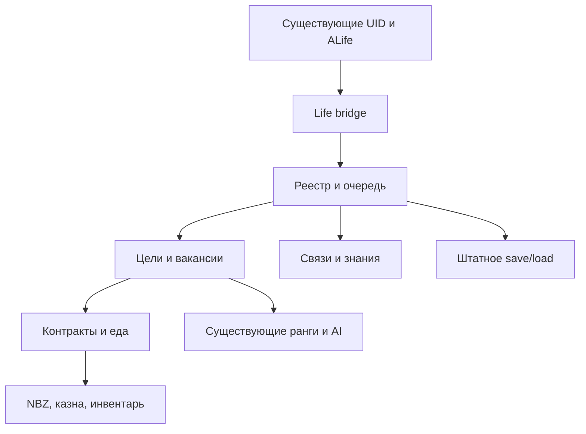

**Русский** · [English](../../en/docs/snapshot-2026-10-28/13_Autonomous_Life_V1/API_CONTRACTS.md)

# Подтверждённые контракты интеграции

Проверены исходники действующей сборки 28.10.2026; нативные сценарии и ограничения перечислены отдельно. Имена не взяты из предполагаемой схемы ТЗ.

| Владелец данных | Используемый API | Контракт |
|---|---|---|
| Личность | `cczmp_ops.person(npc)` | Возвращает UID p<serial>; записывает его в серверное ALife-хранилище. Для мёртвого NPC не создаёт новую личность. |
| Реестр | `cczmp_ops.target_info(uid)` | Отдельная копия записи: object_id, object_name, section, faction, rank. |
| Правовые ограничения | `cczmp_ops.hold_info(uid)` | Задержание/содержание блокирует новую работу и назначение. |
| Сервисное хранилище | `cczmp_ops.service_state()` | Существующие people/contracts/treasury; новые контракты имеют kind=life_wage и ключ life:<uid>. |
| Личные счета | `cczmp_bank.account_state(uid)` | Существующий NBZ-счёт. Первая online-регистрация может перенести 60% наличных NPC на счёт; это старое поведение банка. |
| Переводы | `cczmp_bank.transfer(source,target,amount)` | Проверяет баланс, блокировку, переполнение; меняет реальные счета. |
| Новый банковский адаптер | `cczmp_bank.move_once(source,target,amount,key)` | Атомарная проводка в существующих счетах/казне с квитанцией. Повтор с теми же параметрами не платит второй раз; несовпадающие параметры отклоняются. |
| Организации | `exists`, `rank_count`, `set_object_rank`, `object_rank` из `cczmp_factions` | Существующие поля принадлежности и ранга. У civilians ranks_count=0: профессия меняется без изобретения ведомственного ранга. |
| ALife | `cczmp_runtime.resolve(token)` | Проверяет ID+имя+секцию. Мост дополнительно проверяет серверный cczmp_person_key. |
| Персистентность | `cczmp_items.world()` | Таблица внутри alife_storage_manager; добавлен автономный раздел v1, старый раздел life сохранён. |
| Время | `game.get_game_time():diffSec(ctime)`; `save_ctime` / `load_ctime` | Секунды игрового времени. Пауза не сбрасывает накопленное изменение; загрузка исключается отдельно. |
| Еда | `npc:inventory_for_each`, `se.parent_id`, `alife_release(se)` | Настоящие bread/kolbasa/conserva. Перед резервом проверяется владелец; после удаления подтверждается отсутствие того же токена. |
| Близкое поведение | Существующие `beh@cczmp_life_staff_*` | Старый модуль сохраняет схемы, диалоги, реакции. Новый модуль передаёт ему потребности/фазу; остальные AI-схемы сохраняются. |
| Службы | `cczmp_emergency.dial/select/request`; существующие ridehail/taxi | Эти модули не заменяются симулятором. Полная регрессия вызова/поездки требует отдельных нативных сценариев. |
| Тестовый переход уровня | `_G.JumpToLevel(name)` | Штатная debug-функция из _g.script, вызывает ChangeLevel через game graph. В релизной жизни для мгновенного перемещения не используется. |

Новые публичные функции:

* `cczmp_life_core.register`, `enqueue`, `process`, `pump`, `pause`, `diagnostics`: реестр и очередь с ограничением работы за кадр.
* `cczmp_life_economy.create_contract/work/payroll/eat`: контракты и расход физических ресурсов. Час труда засчитывается только живому свободному сотруднику.
* `cczmp_life_careers.publish/eligible/apply`: вакансия, проверка и назначение. Работодатель не нанимает сам себя. Прямой смены native community нет.
* `cczmp_life_social.learn/share/deliver`: адресные знания с источником и задержкой; `relationship` — ограниченные связи; `org_update` — состав и преемственность групп.

Сохраняются только числа, строки, boolean и таблицы без циклов. Нативные userdata в новый раздел не помещаются. Перед операцией токены разрешаются заново. Исключение — CTime в штатном pstor_ctime, который сериализуется существующей системой движка.

Зарплатный период хранит заработанные часы, статус, сумму и источник. Последовательные оплаченные периоды уплотняются; неоплаченные сохраняются и повторяются в очереди. В банке квитанции не выбрасываются ради освобождения памяти: достижение лимита останавливает новые расчёты.

Схема реальных связей:

